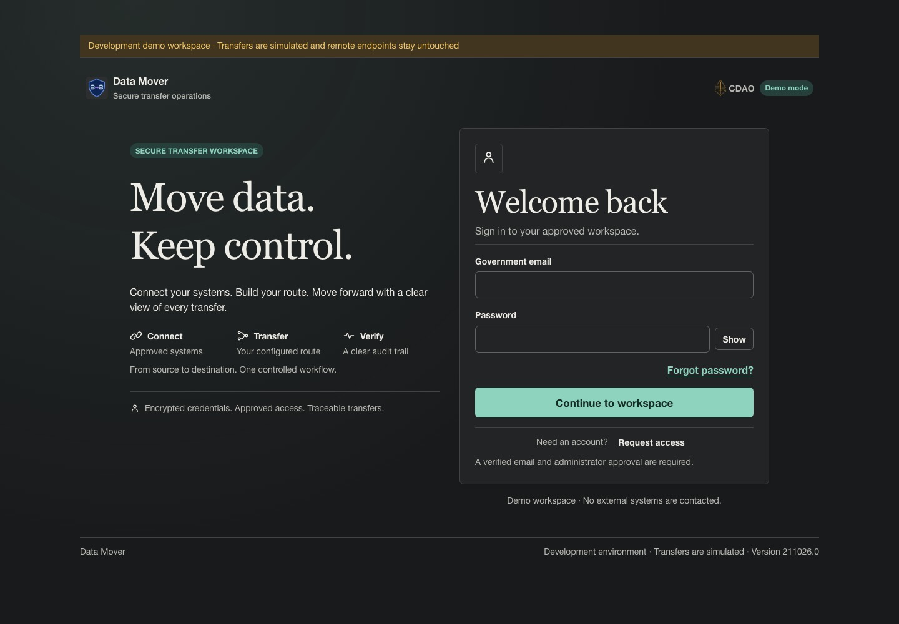
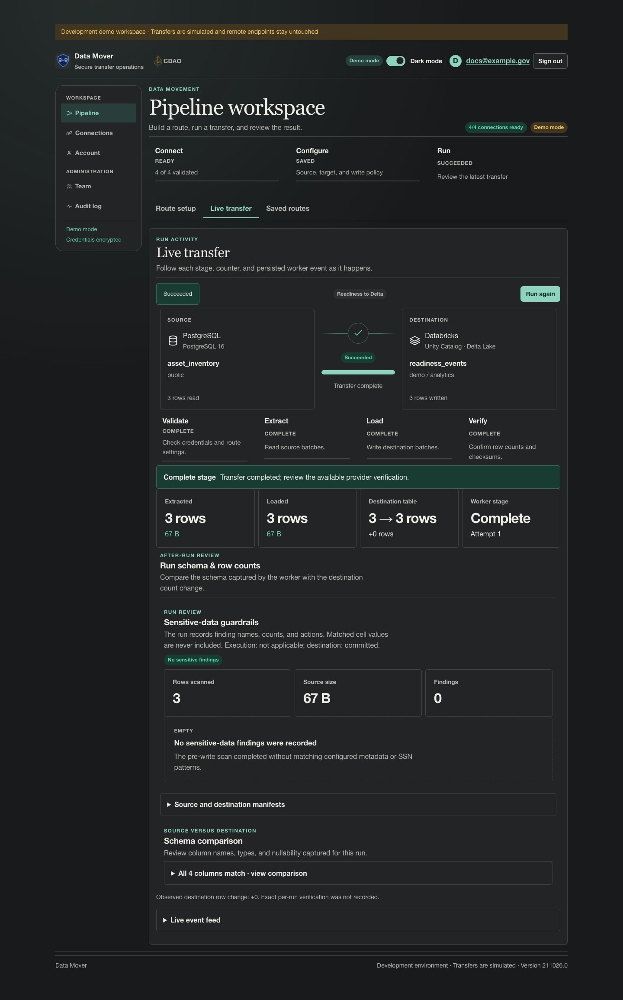
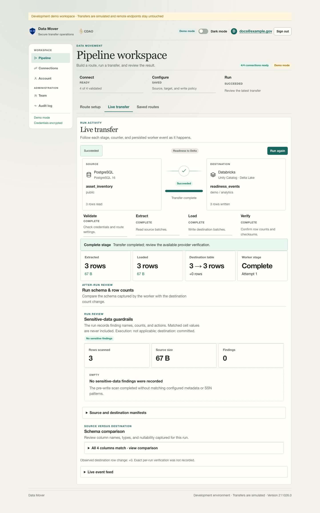
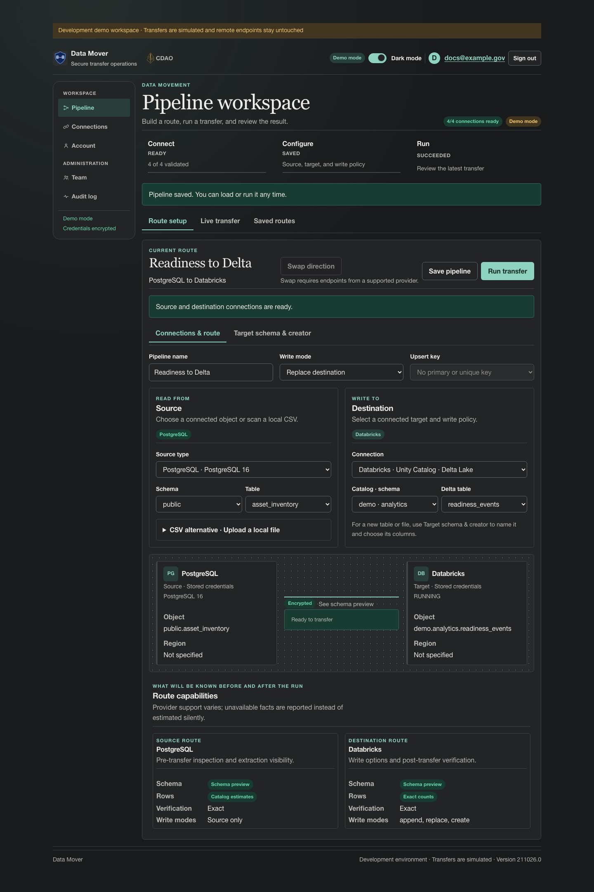
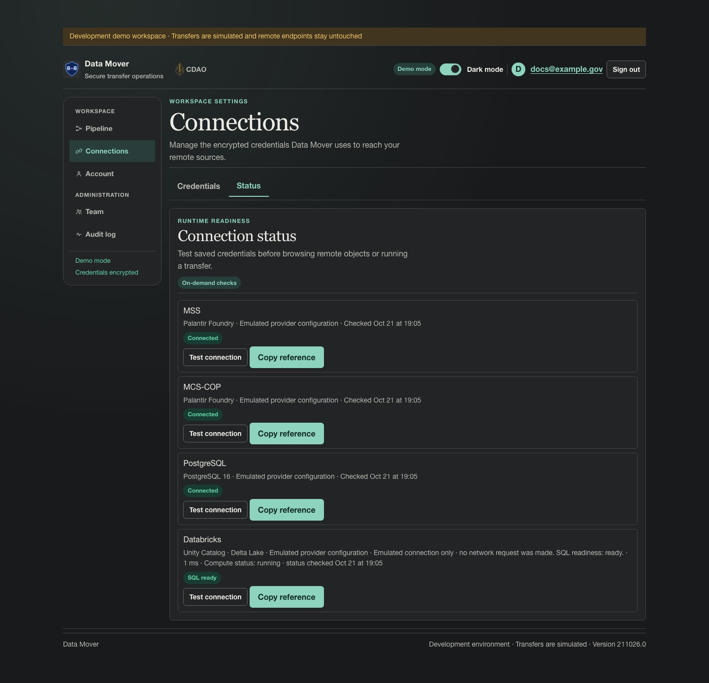
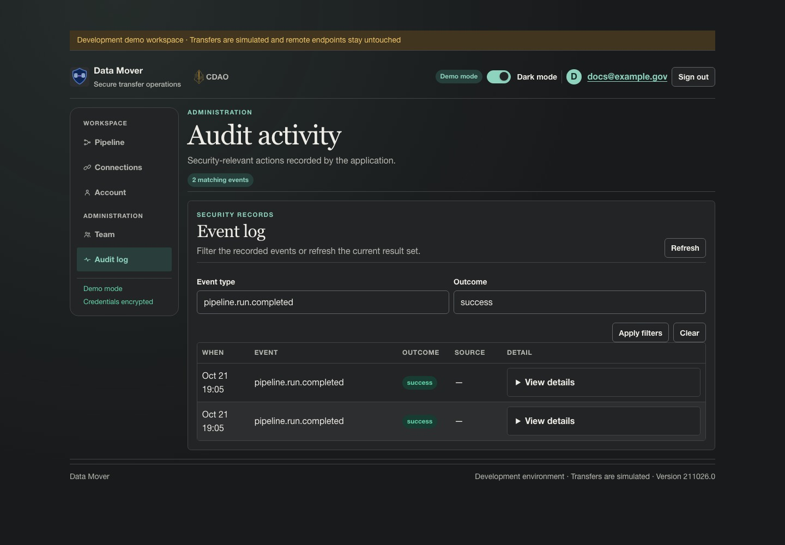

# Data Mover

Data Mover is a self-hosted data-movement application for organizations that want to
configure connections, browse remote objects, save pipelines, and run durable transfers
between MSS, MCS-COP, PostgreSQL, and local CSV files using each user's encrypted credentials.
Databricks connections, browsing, and compute startup controls default to enabled. Source transfers
and Delta create/append/replace require explicit metadata visibility verification. Live writes use
`main.data_mover_staging` by default; see the [operator guide](docs/providers/databricks.md) for
workspace setup and live acceptance status.

It is a **browser UI** (FastAPI + [Hedron](https://github.com/eddiethedean/hedron) + HTMX),
**not a public REST API**. Auth is either local passwords or a trusted identity header behind
an approved CAC/MFA proxy. Set `DATA_MOVER_MODE=demo` for offline fake connectors, or
`DATA_MOVER_MODE=real` for live transfers executed by the Hedron app's in-process background runtime.
Production refuses demo mode.

This software does **not** by itself constitute an ATO, FedRAMP package, or FIPS validation.
See [SECURITY.md](SECURITY.md).

| | |
|--|--|
| Product name | Data Mover |
| Python package / CLI | `access-registry` (`python -m app`) |
| GitHub repository | `user-token-management-app` |
| ASGI entrypoint | `app.main:app` |
| Default local URL | http://127.0.0.1:8000 |
| Default local DB | `./access-registry.db` (SQLite) |

## What it does

- Saved, user-owned pipelines with provider-accurate locators (schema/table or dataset/branch/file)
- MSS, MCS-COP, and PostgreSQL connections in either source or destination roles; CSV uploads are
  source-only
- Databricks Unity Catalog browsing and Delta create, append, and replace, with an offline demo
- In-app Foundry dataset creation for MSS and MCS-COP destination folders
- Owner-scoped CSV sources with header discovery and inferred column data types
- Durable pipeline runs with enqueue, cancel, and HTMX polling against persisted events
- Self-registration (email verify → admin approve) or admin invitations
- Local password sign-in **or** trusted-header federated sign-in
- User profile, session list/revoke, and password change
- Encrypted, provider-specific credentials for MSS, MCS-COP, PostgreSQL, and enabled Databricks
- Connector health checks (fake in demo mode; live in real mode)
- Admin user directory, invitations, approve/deny/disable, audit log
- Asynchronous email delivery built into the web app
- In-process pipeline execution, lease recovery, and retention cleanup
- Preservation checks for timestamp timezone semantics, exact numeric transfers, and CSV parser parity

The [documentation baseline](docs/README.md#current-documentation-baseline) records the October 27
implementation review and links the current credential, data-integrity, and recovery contracts.

## Runtime model

The Hedron app process owns authentication, the UI, persistence, audit records, email delivery,
pipeline execution, and retention cleanup. Work is queued transactionally and handled by lightweight
in-process FastAPI background tasks:

| Process | Responsibility |
|---|---|
| Hedron app (`serve`) | Render the UI, validate requests, enqueue and execute runs, retain state, and expose `/health` |
| In-process email delivery | Drain verification, invitation, registration, password-reset, and account-security messages after email-producing requests |
| In-process transfer task | Claim and continuously renew a lease, decrypt only the selected run credentials, execute the transfer, and persist progress/events |
| In-process maintenance task | Recover queued/expired runs and periodically retain run history, events, catalogs, and spool files |

Email delivery does not use a separate worker process. If the web process restarts before a task
finishes, pending rows remain in the outbox; a later email-producing request or `send-email` drains
them, and `retry-email` requeues dead-lettered messages. Pipeline runs remain durable in the database;
the in-process supervisor recovers queued or expired runs after an app restart. In demo mode,
connectors are fake and stay local. In real mode, the Hedron app is the only process that contacts
configured providers.

## Screenshots

Captured October 21, 2026 from the current Folio desktop UI in an isolated local demo. All four
connections use synthetic credentials and local emulators; no remote endpoints were contacted.
The [screenshot gallery](docs/screenshots/README.md) includes matching light and dark views,
focused transfer panels, and capture/reproduction details.

### Sign in



The sign-in screen introduces the transfer workspace, identifies the demo environment, and keeps
account access and recovery actions together. [Light-mode view](docs/screenshots/login-light.jpg).

### Pipeline workspace



The live monitor shows the source and destination objects, row counts, stage progress, destination
impact, and persisted worker events. Directional packets animate during loading; success settles
into a check mark. Cancelled and failed runs show their recorded destination impact without a
misleading completion meter. Animation honors reduced-motion and forced-colors preferences.

### Live transfer · light



Both modes use Hedron's built-in Folio theme and native cards, icons, typography, badges, and
progress. See the [transfer recordings](docs/screenshots/README.md#transfer-animation) for the
lifecycle in both modes.

### Expanded navigation



The desktop navigation gives access to Pipeline, Connections, Account, Team, and Audit log.
Hedron owns its collapse behavior. Pipeline tabs separate route setup, live monitoring, and saved
routes; the schema tab previews the target before a transfer creates or changes it.

### Connection status



Each provider shows its latest check and an on-demand **Test connection** action. Saved, connected
providers appear in Pipeline selectors; an untested MSS or MCS-COP connection may also appear as a
destination so you can create its first Foundry dataset.

MSS, MCS-COP, and PostgreSQL can each be used as a source or destination. Their writers default to
enabled. The Databricks demo also supports both directions and local Delta create, append, and
replace. Live Databricks transfers require explicit metadata visibility verification; workspace
permissions, startup consent, and runtime checks still apply. The demo is not evidence of live
workspace acceptance. CSV is source-only.
[Light-mode status](docs/screenshots/connections-status-light.jpg).

### Audit activity



Administrators can filter security-relevant events by type and outcome and expand redacted details.
[Light-mode audit view](docs/screenshots/audit-activity-light.jpg).

## Non-goals

- Not a public JSON/OpenAPI resource API (cookie-session HTMX UI only)
- Not identity proofing, clearance verification, or CAC replacement by itself
- Demo mode does not contact remote endpoints; production real mode requires PostgreSQL, a spool
  directory, and an HTTPS host allowlist
- CSV uploads are limited to UTF-8 files of 5 MB or less until streaming quotas exist
- Not a general-purpose run supervisor for arbitrary workloads (see SD-24)
- Advana and MongoDB are not first-class transfer providers in this release

## Documentation map

| Doc | Audience |
|-----|----------|
| [Quick start](#quick-start) (this README) | New operators |
| [docs/user-guide.md](docs/user-guide.md) | People configuring connections and running pipelines |
| [demo-app/README.md](demo-app/README.md) | Minimal Posit Workbench / Connect confidence check |
| [docs/auth-modes.md](docs/auth-modes.md) | Choosing password vs trusted-header |
| [docs/deploy.md](docs/deploy.md) | Posit Connect / Workbench production |
| [docs/troubleshooting.md](docs/troubleshooting.md) | Common failures |
| [docs/faq.md](docs/faq.md) | Short answers |
| [docs/architecture.md](docs/architecture.md) | Trust boundaries and layout |
| [docs/data-pipelines.md](docs/data-pipelines.md) | Current pipeline lifecycle and future scheduling, validation, and transformation architecture |
| [docs/maintainer-guide.md](docs/maintainer-guide.md) | Developer workflow, extension points, testing, and operations |
| [docs/README.md](docs/README.md) | Documentation map, code map, source-of-truth locations, and change recipes |
| [docs/runbooks/pipeline-worker.md](docs/runbooks/pipeline-worker.md) | In-process transfer runtime operations |
| [docs/providers/mss.md](docs/providers/mss.md) | Frozen MSS/Foundry protocol notes |
| [docs/providers/mcscop.md](docs/providers/mcscop.md) | Frozen MCS-COP/Foundry protocol notes |
| [docs/providers/foundry-credentials.md](docs/providers/foundry-credentials.md) | Where to find MSS and MCS-COP endpoint, token, dataset, branch, and TLS settings |
| [docs/providers/postgres.md](docs/providers/postgres.md) | PostgreSQL connector and transactional load semantics |
| [docs/providers/postgres-credentials.md](docs/providers/postgres-credentials.md) | Find host, database, login, and SSL settings in pgAdmin and obtain the database password |
| [docs/providers/databricks.md](docs/providers/databricks.md) | Offline demo, live operator gates, and Delta acceptance/recovery |
| [docs/providers/databricks-credentials.md](docs/providers/databricks-credentials.md) | Where to find workspace, token, and compute connection details |
| [docs/screenshots/README.md](docs/screenshots/README.md) | Current desktop gallery and screenshot reproduction |
| [docs/hedron.md](docs/hedron.md) | Hedron integration and feature coverage |
| [docs/plans/README.md](docs/plans/README.md) | Roadmap artifacts, ETL/security contracts, ADE learning path, and delivery evidence |
| [examples/no_node_data_app/README.md](examples/no_node_data_app/README.md) | Runnable FastAPI + Hedron + HTMX example without Node.js or Streamlit |
| [SECURITY.md](SECURITY.md) | Decision register + production gate |
| [CONTRIBUTING.md](CONTRIBUTING.md) | Development and UI contributions |
| [CHANGELOG.md](CHANGELOG.md) | Release notes |

## Prerequisites

- **Python 3.11+** (CI runs 3.11, 3.12, and 3.13)
- Network access to install dependencies from PyPI
- **Development:** SQLite (default)
- **Production:** PostgreSQL (`postgresql+psycopg://…`), HTTPS, SMTP — see [docs/deploy.md](docs/deploy.md)

If you want to validate Posit Workbench and Connect before configuring the full application, start
with the dependency-light [demo app](demo-app/README.md).

## Quick start

```bash
python3 -m venv .venv
source .venv/bin/activate   # Windows: .venv\Scripts\activate
python -m pip install -e ".[dev]"
cp .env.example .env
# Edit .env if needed; local defaults work with console email.
python -m app migrate
ADMIN_BOOTSTRAP_PASSWORD='Your-Long-Password-15+' python -m app create-admin \
  --email admin@example.gov --password-env ADMIN_BOOTSTRAP_PASSWORD
python -m app serve --reload
```

Open http://127.0.0.1:8000/login and sign in with the admin email and password.

**Password rules (local_password):** 15–128 characters after Unicode NFC normalization;
must not contain the email local-part or a built-in common password.

**Interactive admin create** (no env var): `python -m app create-admin --email admin@example.gov`
(prompts for password). The same command **promotes** an existing user to administrator.

Email delivery starts automatically with the app when an email-producing request completes. With
`EMAIL_BACKEND=console`, verification and reset links print to the app log. There is no separate
email worker to start; `send-email` remains available for one-shot recovery and `retry-email`
requeues dead letters.

## Explore the demo

For a one-command local demo with a dedicated account and fake credentials for four provider
connections:

```bash
make demo
```

Open the URL printed by the script and use its email/password. On a local machine this is
`http://127.0.0.1:8765/login`; in Workbench the launcher asks `rserver-url` for the exact session URL
for port 8765 and configures Hedron with the same mount. Do not reuse a session URL created for port
8000. The script migrates a local SQLite database, creates the demo administrator, stores encrypted
values under reserved `.demo.invalid` hosts, and starts Data Mover. These values are intentionally
fake and the seeding command refuses to run in production.

After signing in:

1. Open **Connections → Credentials** and review the seeded MSS, MCS-COP, PostgreSQL, and Databricks
   connections. Every value is encrypted, and the saved plaintext is never displayed again.
2. Open **Connections → Status** and review the automatic checks from the saved connections. Use
   **Test connection** to repeat a check without changing credentials.
3. Open **Pipeline → Route setup** and choose existing source and destination objects from the
   demo catalogs. Saved, validated connections appear in the selectors; an untested MSS or MCS-COP
   connection is available only as a destination when creating its first Foundry dataset. CSV files
   may also be uploaded, scanned, and used as sources.
4. Select a write mode, save the route, and run it. Use **Live transfer** to follow persisted run
   events and **Saved routes** to load a reusable pipeline.

Demo mode does not contact remote systems. Its health result is explicitly labeled **Emulated
connection only** and cannot validate a hostname or credential. The process-local emulator does
exercise branch-aware catalogs, bounded batches, transactional write modes, uniqueness conflicts,
abort behavior, and cross-instance destination state. Use only non-sensitive test values and data.
The complete workflow is in the [Data Mover user guide](docs/user-guide.md).

The Databricks demo includes an always-ready simulated SQL warehouse, `demo.analytics` and
`demo.staging` schemas, and synthetic Delta tables. Use it as either a source or destination;
create, append, and replace run locally without a Databricks account or compute costs. Emulator
table changes last for the app process. Built-in table IDs remain stable across restarts so
saved routes to unchanged seed tables still work; tables created during a session must be recreated
after restart. `make demo` enables this provider by default; set
`PIPELINE_ENABLE_DATABRICKS=false` to omit it. Real-mode transfers require explicit metadata
visibility verification; live writes use `main.data_mover_staging` unless overridden.

## CLI reference

All of these are available as `python -m app …` or `access-registry …`.

| Command | Purpose |
|---------|---------|
| `migrate` | Upgrade schema to Alembic head |
| `migrate --adopt-existing` | Stamp a verified pre-Alembic DB, then upgrade |
| `schema-status` | Show current vs expected revision |
| `create-admin --email …` | Create or promote an administrator |
| `create-admin … --password-env VAR` | Non-interactive password from env |
| `seed-demo-connections --email … [--replace]` | Create or refresh recognized fake credentials in a development account; refused in production and real mode |
| `serve [--host] [--port] [--reload] [--discover]` | Local / Workbench-aware server; `--discover` requests bind-then-discover when supported |
| `send-email` | One-shot drain of queued email (manual recovery) |
| `retry-email [--message-id ID] [--limit N]` | Requeue dead-lettered messages |

Schema must be current before `create-admin` or `serve` (startup checks).

## Make targets

| Target | Action |
|--------|--------|
| `make install` | `pip install -e ".[dev]"` |
| `make migrate` | `python -m app migrate` |
| `make schema-status` | Show Alembic revisions |
| `make serve` | `python -m app serve --reload` |
| `make demo` | Create/refresh a local demo account, seed four fake provider connections, and serve on port 8765 |
| `make create-admin` | Uses `ADMIN_EMAIL` (default `admin@example.gov`); set `ADMIN_BOOTSTRAP_PASSWORD` for non-interactive local mode |
| `make lint` | Run Ruff lint checks only |
| `make format` | Reformat Python files with Ruff |
| `make format-check` | Check Ruff formatting without changing files |
| `make typecheck` | Run basedpyright only |
| `make test-file FILE=…` | Run one focused pytest file using the repository interpreter |
| `make docs-check` | Check local Markdown link targets |
| `make check` | Run the complete CI-quality gate: lint, formatting, types, docs, Hedron/Posit checks, pytest (80% coverage gate), and demo-app tests |
| `make hedron-check` | Validate Hedron routes and interaction contracts |
| `make hedron-security-check` | Write the strict Hedron security posture report |
| `make posit-check` | Validate HedronPosit deployment and cookie-path matrix |
| `make hedron-build` | Build the production Hedron asset manifest |
| `make demo-check` | Run the dependency-isolated demo-app tests |
| `make databricks-check` | Run Databricks regression tests and local MiniLake SDK management integration tests |
| `make workbench-up` | Start licensed Posit Workbench + app Docker stack (needs `PWB_LICENSE`) |
| `make workbench-test` | Opt-in Workbench Docker integration tests |
| `make workbench-logs` | Show recent Workbench/app container logs |
| `make workbench-down` | Graceful stop (important for license-key deactivation) |
| `make connect-smoke` | Run the optional licensed Posit Connect smoke test |

## Configuration

Copy [.env.example](.env.example) for secrets and deployment-specific overrides. Stable local
defaults are committed in `app/config.py`; the purpose of every setting is documented in
[docs/configuration.md](docs/configuration.md).
Auth modes: [docs/auth-modes.md](docs/auth-modes.md).

Production refuses insecure settings (HTTPS `PUBLIC_BASE_URL`, `COOKIE_SECURE`, Postgres,
SMTP, rate limits, and more). Checklist: [SECURITY.md — Production security gate](SECURITY.md#production-security-gate).

## Posit Workbench and Connect

For Posit Workbench live deployment, use the [two-path deployment guide](docs/deploy.md). The
Workbench path uses real provider connections, PostgreSQL, and one session-scoped app process.

For a local fake-connector demo:

```bash
source .venv/bin/activate
make demo
```

For Posit Connect, use the short [Connect deployment guide](docs/deploy.md). The supported path
uses PostgreSQL, direct `rsconnect` commands, native Connect cookie handling, and the app's
in-process email, transfer, recovery, and retention runtime. There is no SQLite Connect path.

Optional local regression against a real Workbench image (put a trial key in `.env` only —
never commit it):

```bash
# PWB_LICENSE=… in .env
make workbench-up
make workbench-test
make workbench-down
```

Details: [docker/README.md](docker/README.md).

## Contributing

See [CONTRIBUTING.md](CONTRIBUTING.md) for setup, tests, and how to add an HTMX page. The
[documentation guide](docs/README.md) is the quickest way to find the right code, test, or runbook
when fixing a problem.

## License

[MIT](LICENSE)
