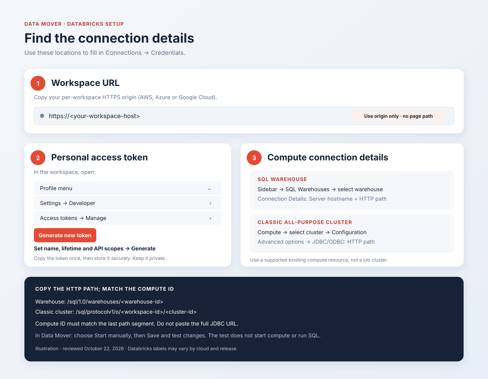

# Find and enter your Databricks connection details

Use this guide for **Connections → Credentials → Databricks** in Data Mover. You need
five values from the **same workspace and compute resource**: a workspace URL, a workspace
personal access token (PAT), a compute type, a compute ID, and a SQL HTTP path. You also choose
a startup policy in Data Mover.

**Reviewed October 22, 2026** against the official sources linked below and this app's
[credential fields](../../app/services/secret_catalog.py),
[input validation](../../app/services/secret_validation.py), and
[connector](../../app/connectors/databricks.py). These instructions describe the implemented
connection flow; live acceptance remains pending in the [operator guide](databricks.md).

*The map above is an illustration. The Databricks reference screenshot in step 3 and the
Data Mover screenshot in step 4 are actual captures, with their sources identified.*

## Before you test a live connection

Ask the operator to confirm that the deployment uses **`DATA_MOVER_MODE=real`** and has the
required [runtime configuration](../configuration.md#production) before entering real credentials.
The app defaults to `demo`, which uses emulators: **Connected** in an emulated check does not
verify remote credentials or access. The connection-check descriptions below apply to live mode.

In **Connections → Status**, read the full check message. An emulated/no-network result is not
a live check. After the operator changes the runtime mode, use **Test connection** again to
replace any previously saved emulated result. The [Databricks operator gates](databricks.md#operator-gates)
and live acceptance requirements still apply.

## 1. Copy the workspace URL

Sign in to the workspace you intend to query. Copy `https://` and the hostname from the address
bar; remove the page path, `?o=...` workspace query, and any `#...` fragment. Use a per-workspace
URL, rather than a legacy regional URL or the Databricks account console.
[Databricks explains workspace URLs and IDs here](https://docs.databricks.com/aws/en/workspace/workspace-details).

| Cloud | Typical workspace URL shape | Where to look |
| --- | --- | --- |
| AWS | `https://<workspace-name>.cloud.databricks.com` | Browser address bar after opening the workspace. |
| Azure | `https://adb-<workspace-id>.<number>.azuredatabricks.net` | Workspace address bar, or the Azure workspace resource's URL / **Launch Workspace**. See [Azure per-workspace URLs](https://learn.microsoft.com/en-us/azure/databricks/workspace/per-workspace-urls). |
| Google Cloud | `https://<workspace-id>.<number>.gcp.databricks.com` | Workspace address bar. See [Google Cloud workspace URLs](https://docs.databricks.com/gcp/en/workspace/workspace-details). |

These are shapes, not values to paste. Use your workspace's actual hostname. If you copy
**Server hostname** from compute connection details instead, prefix it with `https://` for
Data Mover's **Workspace URL** field. The connector uses this same host for management and SQL
requests, so the hostname must match your chosen compute's connection details.

## 2. Create a workspace personal access token

In that workspace:

1. Open your username/profile menu in the top bar and choose **Settings**.
2. Select **Developer**, then **Manage** beside **Access tokens**.
3. Choose **Generate new token**.
4. Give it a recognizable name, such as `Data Mover acceptance`, and a lifetime permitted by
   your workspace policy.
5. Review API scopes with your administrator if the token dialog offers them; see below.
6. Click **Generate**, copy the token to a secure location, and click **Done**. A lost token
   must be replaced.

Official token instructions: [AWS](https://docs.databricks.com/aws/en/dev-tools/auth/pat),
[Azure](https://learn.microsoft.com/en-us/azure/databricks/dev-tools/auth/pat),
[Google Cloud](https://docs.databricks.com/gcp/en/dev-tools/auth/pat).
Databricks recommends OAuth where possible; this app currently implements **workspace PAT
authentication only**. An OAuth client secret, cloud access key, workspace ID, and Databricks
password are not substitutes for this field.

For unattended use on Posit Connect, ask your administrator which identity should own the token.
When PATs are used for automation, Databricks [recommends a service-principal PAT](https://docs.databricks.com/aws/en/dev-tools/sql-execution-tutorial#prerequisites).
Have the administrator follow the token instructions for your cloud; enter the resulting PAT
value in Data Mover, rather than the service principal's application ID or OAuth secret.

### Check API scopes separately from permissions

The following maps the app's management calls to Databricks' published [API scopes](https://docs.databricks.com/api/workspace/scopes):

| Selected compute | Management calls used by the app | API scope family |
| --- | --- | --- |
| SQL warehouse | Get warehouse details/state; start warehouse when explicitly requested or consented | `sql` |
| Classic cluster | Get cluster details/state; start cluster when explicitly requested or consented | `clusters` |

This is a mapping from code and documentation, **not a live-tested complete scope recipe**.
The token must also support SQL Connector sessions for browsing and transfers. Have the operator
verify the intended SQL workflow with the chosen scopes; do not assume a **BI Tools** preset
covers every management call. Token scopes do not grant compute ACLs or Unity Catalog privileges.

## 3. Copy the compute ID and HTTP path

### Option A: SQL warehouse

1. In the workspace sidebar, open **SQL Warehouses** (under **SQL** in some layouts).
2. Open the warehouse your administrator has assigned to you.
3. Open **Connection Details** and copy **Server hostname** and **HTTP path**.
4. In Data Mover, choose **SQL warehouse** for **Compute type**. Use the last segment of the
   HTTP path as **Compute ID**; copy the whole path into **SQL HTTP path**.

Example values, for illustration only:

| Data Mover field | Value |
| --- | --- |
| Compute type | SQL warehouse (`warehouse`) |
| Compute ID | `1a2b3c4d5e6f7890` |
| SQL HTTP path | `/sql/1.0/warehouses/1a2b3c4d5e6f7890` |

The [current connection-detail instructions](https://docs.databricks.com/aws/en/integrations/jdbc-oss/configure#configure-the-connection)
show the same fields used by the [SQL Connector for Python](https://docs.databricks.com/aws/en/dev-tools/python-sql-connector#get-started).
Databricks confirms the [warehouse ID is the suffix of this HTTP path](https://docs.databricks.com/aws/en/dev-tools/sql-execution-tutorial#prerequisites).

### Option B: compatible all-purpose classic cluster

1. Open **Compute** in the sidebar and select the cluster.
2. Open **Configuration → Advanced options → JDBC/ODBC** and copy **Server Hostname** and
   **HTTP Path**. See the [connection-detail instructions](https://docs.databricks.com/aws/en/integrations/jdbc-oss/configure#configure-the-connection).
3. Copy the cluster ID after `/compute/clusters/` in the cluster page's browser URL.
4. In Data Mover, choose **Classic cluster** and enter that ID and the complete HTTP path.

Example values, for illustration only:

| Data Mover field | Value |
| --- | --- |
| Compute type | Classic cluster (`classic_cluster`) |
| Compute ID | `0807-000654-abcdefgh` |
| SQL HTTP path | `/sql/protocolv1/o/1234567890123456/0807-000654-abcdefgh` |

The number after `/o/` is the workspace component, **not** the cluster ID. Copy the full HTTP
path from Databricks rather than constructing it from the example.

*Screenshot: Databricks, [Get identifiers for workspace objects](https://docs.databricks.com/aws/en/workspace/workspace-details#compute-resource-url-and-id).
Hosted by Databricks; an internet connection is required to load it.*

The app checks for an existing all-purpose classic cluster, Databricks Runtime **13.3 or later**,
and API access mode `USER_ISOLATION` or `SINGLE_USER`. The current UI calls the corresponding
modes **Standard** and **Dedicated** (formerly single user); see [access-mode naming](https://docs.databricks.com/aws/en/compute/simple-form#access-mode-naming-updates).
Passing these checks does not establish support for every Dedicated configuration. The operator
must verify that the token identity can use the selected cluster. Jobs compute and serverless
notebook/job compute are outside this classic-cluster path; the Python SQL Connector also
[excludes jobs compute](https://docs.databricks.com/aws/en/dev-tools/python-sql-connector#get-started).

For either option, enter **only the path** in **SQL HTTP path**, not a browser URL or the full
`jdbc:databricks://...` connection string. The ID in the path must exactly match **Compute ID**.

## 4. Enter the values and test in Data Mover

Open **Connections → Credentials**, scroll to **Databricks**, and fill in:

| Field | What to enter |
| --- | --- |
| Workspace URL | The `https://` workspace origin from step 1 |
| Personal access token | The token value from step 2, without surrounding whitespace or a `Bearer ` prefix |
| Compute type | **SQL warehouse** or **Classic cluster**, matching step 3 |
| Compute ID | The resource ID from step 3, not its display name or the workspace ID |
| SQL HTTP path | The complete path from the same compute resource |
| Startup policy | **Start manually** initially, or **Allow automatic startup** when you intend to authorize it |
| Token expires at (UTC) | Optional: the token's expiry from Databricks, converted to UTC; leave blank if unknown |

Choose **Save and test connection** for the first save, or **Save and test changes** when replacing
credentials, then review **Connections → Status**. An unchanged credential submission keeps the
previous result without contacting Databricks; use **Test connection** to request a fresh check.

### See when the token expires

The token list under **Settings → Developer → Access tokens → Manage** is the place to review
the token's lifetime. Enter its UTC expiry in the optional field when it cannot be detected.
During a live connection check, Data Mover also makes a best-effort read of the
[List tokens API](https://docs.databricks.com/api/tokens/v1/list-tokens) and uses expiry metadata
only when its token ID matches the SHA-256 hash of the saved token, as described in the
[token API reference](https://docs.databricks.com/api/tokens/v1/update-token).
The API reports expiry in epoch milliseconds, or `-1` when not applicable.

If token metadata is unavailable, access is denied, or no token ID matches, the connection
check can still succeed. The optional lookup uses a separate HTTP client with two-second network
timeouts and no automatic retries or redirects, so it does not inherit the SDK's long retry budget.
Data Mover retains an available date or shows **Unknown**; do not add
token-management privileges or the broad `authentication` scope just to populate this display.
Provider metadata takes precedence over an entered date. The date and its source appear in
**Credentials** and **Status**, with warnings within seven days and after the date passes.
See [Token expiry](../user-guide.md#token-expiry) for the fallback behavior and advisory limits.
In live mode, that check makes management API calls to validate authentication and inspect compute;
it does **not** submit SQL or start compute. A connected result, even one reporting SQL readiness,
does not prove SQL/data permissions, complete metadata visibility, or transfer readiness.
Saved credential values are encrypted and are not shown again.

With **Start manually**, start stopped compute explicitly before a SQL action. **Allow automatic
startup** authorizes Data Mover to request startup when needed, subject to the operator's startup
control. Changing the workspace, token, compute, or SQL path resets startup consent. Starting
compute may incur charges; Data Mover does not stop it. See [startup behavior](databricks.md#current-live-scope).

View the actual Data Mover credential screen

*Existing October 21, 2026 offline-demo capture, version `211026.0`; synthetic credentials only.
See the [capture gallery and manifest](../screenshots/README.md) for provenance. This shows the
form layout, not evidence of a live Databricks connection.*

## Access your administrator must arrange

Ask for the permissions needed by your intended operation, rather than workspace administration:

| Need | Access to check |
| --- | --- |
| Use a SQL warehouse | `CAN USE` on the selected warehouse; the app must be able to retrieve its details. |
| Use a classic cluster | `CAN ATTACH TO` and eligibility to use its access mode; `CAN RESTART` if startup is needed. |
| Read a Unity Catalog table | `USE CATALOG`, `USE SCHEMA`, and `SELECT` on the source table. |
| Create a Delta destination | Parent `USE CATALOG` / `USE SCHEMA`, plus `CREATE TABLE` on the destination schema. |
| Append to a Delta destination | Parent usage privileges, plus `SELECT` and `MODIFY` on the destination table. |
| Replace an existing Delta destination | Parent usage privileges, `CREATE TABLE` on its schema, and `MANAGE` on the table or ownership. |

Sources: [compute connection permissions](https://docs.databricks.com/aws/en/integrations/jdbc/compute),
[workspace ACLs](https://docs.databricks.com/aws/en/security/auth/access-control/), and
[Unity Catalog table permissions](https://docs.databricks.com/aws/en/tables/tables-concepts#basic-table-permissions).
These are operation-level starting points; the operator must also verify the app's metadata
inspection, staging, publication, and cleanup workflow under the workspace's policies.

For writes, an operator must provision an **existing private** staging schema, default
`main.data_mover_staging`. The token identity must be able to create, write, inspect, and drop
its staging tables, as well as publish to the destination. `USE CATALOG`, `USE SCHEMA`, and
`CREATE TABLE` alone do not describe every destination operation's permissions. The app does
not create the staging catalog/schema. See [write setup](databricks.md#connection-setup-in-an-acceptance-environment).

For a Posit Connect deployment, the operator must also allow the exact workspace hostname in
`PIPELINE_ALLOWED_HTTPS_HOSTS` and ensure the **Connect runtime** has network/DNS/TLS access.
Being able to open Databricks from your laptop does not establish server access. Schema inspection,
row counts, transfers, and writes require explicit metadata visibility verification; an empty
tag query is not proof of coverage. See the [deployment gates](databricks.md#operator-gates).

## Troubleshoot by symptom

| Symptom | What to check next |
| --- | --- |
| Databricks is missing from Connections | Ask the deployment operator whether `PIPELINE_ENABLE_DATABRICKS=false` is hiding it. The connection form defaults to enabled. |
| No token controls, or token creation denied | Workspace PAT settings, permission to create/use PATs, and token lifetime policy. See [token administration](https://docs.databricks.com/aws/en/admin/access-control/tokens). |
| Workspace URL rejected or endpoint blocked | Use an HTTPS workspace origin and the operator-approved hostname. Remove route/query/fragment; check `PIPELINE_ALLOWED_HTTPS_HOSTS`. |
| HTTP-path validation fails | Match the chosen compute type and ID to the exact path formats in step 3. Do not paste the JDBC URL. |
| Authentication or permission failure | Check token expiry/revocation, workspace match, API scopes, and access to that specific compute. These failures can have more than one cause. |
| Connected, but SQL is not ready | Check the reported compute state and startup policy. Credential tests do not start compute. |
| Connected, but browsing or a transfer fails | Check SQL/data privileges, supported compute/table type, deployment gates, and runtime network access. A management-only test cannot prove these. |
| Staging or destination write fails | Verify the configured private staging schema exists and the identity has staging and target privileges for the chosen write mode. |

To rotate an expired or revoked PAT:

1. Open **Connections → Credentials → Databricks** and enter the **complete replacement bundle**:
   workspace URL, new PAT, compute type, compute ID, SQL HTTP path, and startup policy. Saved
   values are not prefilled, and submitting only the new PAT fails validation.
2. Choose **Save and test changes** and review the live result under **Connections → Status**.
3. Review startup consent. A changed PAT resets the policy to **Start manually**, even if automatic
   startup was selected in the replacement submission. To authorize it again, submit the same
   complete bundle with the new PAT and **Allow automatic startup**, subject to the operator's
   startup control.

The app does not refresh PATs automatically. Share sanitized error messages with your operator;
keep token values out of screenshots, tickets, and logs.
