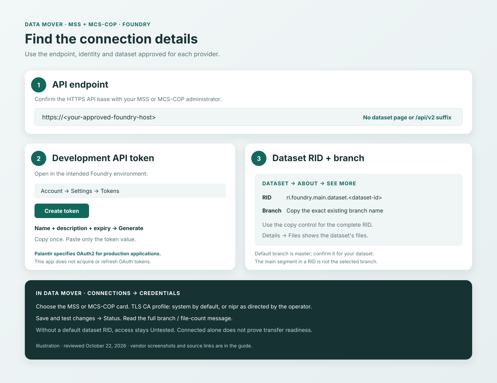
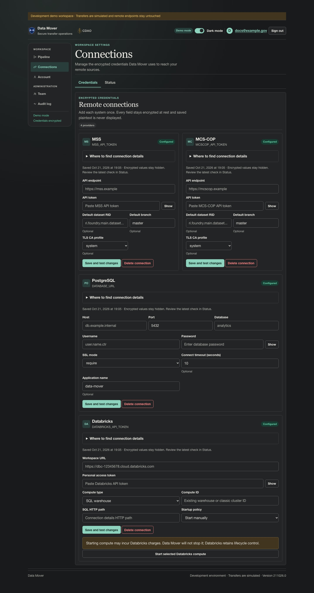

# Find and enter Foundry connection details for MSS and MCS-COP

Use this guide for the **MSS** and **MCS-COP** cards in **Connections → Credentials**.
Both use the same Foundry connection fields. Configure each card with its own approved endpoint,
token, dataset, and branch; a working MSS connection does not establish access to MCS-COP.
Your platform administrator must confirm the deployment-specific hostnames and authentication policy.

**Reviewed October 22, 2026** against the official Palantir sources linked below and this app's
[credential catalog](../../app/services/secret_catalog.py),
[validation](../../app/services/secret_validation.py), and
[shared Foundry connector](../../app/connectors/foundry.py).
The public screenshots illustrate Foundry controls, not a verified MSS or MCS-COP deployment.

*This map is an illustration. The attributed Palantir images and Data Mover capture below are
actual screenshots; layouts can differ by deployment and release.*

## Before you test a live connection

Ask the operator to confirm that the deployment uses **`DATA_MOVER_MODE=real`** and has the
required [runtime configuration](../configuration.md#production) before entering real credentials.
The app defaults to `demo`, which uses emulators: **Connected** in an emulated check does not
verify remote credentials or access. The connection-check descriptions below apply to live mode.

In **Connections → Status**, read the full check message. An emulated/no-network result is not
a live check. After the operator changes the runtime mode, use **Test connection** again to
replace any previously saved emulated result. Real mode does not add the OAuth integration
described below.

## Authentication for development and production

Palantir's [authentication documentation](https://www.palantir.com/docs/foundry/api/general/overview/authentication)
limits user-generated tokens to development and specifies OAuth2 for production applications.
Personal tokens inherit the creating user's permissions; they are not independently scoped
service credentials.

Data Mover currently stores a supplied bearer token and sends it in the authorization header.
It does **not** implement an OAuth authorization flow, client-credentials exchange, or automatic
token refresh. Pasting a client ID or client secret into **API token** does not add that support.
For a production Posit Connect deployment, resolve the OAuth integration and token lifecycle
with the application maintainer and Foundry administrator. The personal-token steps below are
for development/testing and do not establish production authentication readiness.

## 1. Confirm the API endpoint

Ask the MSS or MCS-COP administrator for that environment's approved **Foundry API base URL**.
For a standard Foundry deployment this is an HTTPS origin, for example
`https://<your-foundry-host>`. The normal Foundry web address can help identify it, but confirm
that it is the intended API host. Palantir's [connection setup guide](https://www.palantir.com/docs/foundry/analytics-connectivity/power-bi-getting-started)
shows the Foundry base URL concept; Data Mover uses the REST API, rather than Power BI or JDBC.

Do not paste a dataset preview URL, an SSO login URL, a full `/api/v2/...` request URL, or a
URL containing a token. The app appends paths such as `/api/v2/datasets/...` to this base.
Use a gateway path prefix only when your operator explicitly supplies it; the adapter preserves
that prefix. In real mode, the host must match `PIPELINE_ALLOWED_HTTPS_HOSTS` policy.

## 2. Create a development token in the correct Foundry environment

1. Open **Account** at the bottom of the Foundry sidebar.
2. Choose **Settings → Tokens → Create token**.
3. Enter a useful name and description, and an expiry date permitted by your administrator.
4. Choose **Generate** and copy the displayed token to a secure location. It is shown only once.
5. Paste just the token value into the matching Data Mover card's **API token** field. Do not
   include quotes, surrounding whitespace, or the `Bearer ` prefix; the app adds that prefix.

Source: Palantir's [user-generated token instructions](https://www.palantir.com/docs/foundry/platform-security-third-party/user-generated-tokens).
If these controls are unavailable, ask your environment administrator which authentication
methods and API access are permitted. Keep token values out of screenshots, tickets, and logs.

*Screenshot: Palantir, [User-generated tokens](https://www.palantir.com/docs/foundry/platform-security-third-party/user-generated-tokens).
This reference image contains historical sample dates; it is not a capture of MSS or MCS-COP.
Vendor-hosted images require internet access to load.*

## 3. Copy the dataset RID, branch, and file details

Open the dataset you are authorized to use in that same Foundry environment:

1. In the dataset's **About** panel, choose **see more** and find **RID**.
2. Use the copy control to obtain the **complete RID**, such as
   `ri.foundry.main.dataset.00000000-0000-4000-8000-000000000001` (illustrative only).
3. Check the selected **branch** in the dataset header or expanded information panel. Copy its
   exact name into **Default branch** in Data Mover.
4. Open **Details → Files** to check that the selected branch contains the files you intend
   to read. Data Mover sources support `.csv` and `.parquet` files.

Palantir documents [where to copy the RID](https://www.palantir.com/docs/foundry/analytics-connectivity/identify-dataset-rid)
and the [dataset header, information panel, and Files view](https://www.palantir.com/docs/foundry/dataset-preview/overview).
Use the RID, not the dataset's display name, **Location** path, a transaction RID, or a folder RID.

*Screenshot: Palantir, [Identify a dataset's RID or filepath](https://www.palantir.com/docs/foundry/analytics-connectivity/identify-dataset-rid).
The RID text is horizontally clipped in the reference image; use the clipboard control to copy
its full value, rather than transcribing the visible suffix.*

**Default dataset RID** is optional in the credential form, but the current health check needs
it to list files and verify dataset access. Data Mover does not search all Foundry datasets.
A route can also use a saved dataset or one created through the Pipeline page.

The app defaults **Default branch** to `master`; choose a different existing branch explicitly
when appropriate. A dataset branch is not the `main` segment inside a RID. Foundry's
[branching guide](https://www.palantir.com/docs/foundry/data-integration/branching) describes dataset
branches. A saved transfer uses its exact branch and does not silently switch branches.

### If you want to create a destination dataset

The Pipeline destination editor needs a **parent folder RID**, for example
`ri.compass.main.folder.00000000-0000-4000-8000-000000000002` (illustrative only), plus a dataset
name. Ask the folder owner/administrator for the correct RID and create permission. Do not enter
a folder RID in **Default dataset RID**. See the [Create Dataset API](https://www.palantir.com/docs/foundry/api/datasets-v2-resources/datasets/create-dataset).

The app currently records newly created datasets on `master`. Palantir describes `master` as
the default for most enrollments, so the operator must verify this behavior on environments
with another default. Existing destination routes retain their configured branch.

## 4. Choose the TLS CA profile

This is a deployment setting, not a value you retrieve from a dataset:

| Data Mover choice | Current behavior |
| --- | --- |
| **system** | Uses the HTTP client's default certificate trust configuration. This is the form default. |
| **nipr** | Uses the operator's `PIPELINE_CA_BUNDLE` when configured; otherwise the client still uses default certificate verification. |

Selecting **nipr** does not install certificates or provide network access. Ask the operator which
profile matches the deployment and whether the required certificate chain is installed on the
Posit Connect runtime. The app has no form option to disable TLS verification.
See the [connector TLS implementation](../../app/connectors/tls.py) and
[configuration reference](../configuration.md#complete-override-inventory).

## 5. Enter the values and check the result

Use the **MSS** card for MSS and the **MCS-COP** card for MCS-COP:

| Field | What to enter |
| --- | --- |
| API endpoint | The administrator-approved HTTPS API base URL from step 1 |
| API token | The bearer token value for that environment and identity |
| Default dataset RID | The full dataset RID from step 3; optional to save, needed for the dataset access check |
| Default branch | The exact dataset branch; the app defaults to `master` |
| TLS CA profile | **system** or **nipr**, as directed by the deployment operator |
| Token expires at (UTC) | Optional: the token's expiry from Foundry, converted to UTC; leave blank if unknown |

Choose **Save and test connection** for the first save, or **Save and test changes** when replacing
credentials, then read **Connections → Status**, including the full message. An unchanged
credential submission does not repeat the remote check; use **Test connection** to request a fresh
check. In live mode, the test lists file metadata and does not upload files or create datasets.

The optional expiry field records the date supplied by your token issuer. Data Mover can also
read an `exp` claim from a JWT and labels that date **unverified token claim**; this is a local
decode, not a Foundry signature or token-introspection check. An entered date takes precedence
over that claim. Opaque tokens without an entered date show **Unknown**. Both **Credentials**
and **Status** warn within seven days of a known date and after it passes. These warnings do
not establish token validity or renew a token. See [Token expiry](../user-guide.md#token-expiry).

| Check result | What it establishes |
| --- | --- |
| **Untested**, asking for a default dataset RID | No remote dataset access was verified. Supply an authorized RID or configure the intended dataset through the Pipeline flow. |
| **Connected**, with a branch and file count | The file listing succeeded on the branch named in the message. It does not prove file download, sensitivity-metadata access, or write permissions. |
| **Connected**, with “Default dataset was not found” | The current connector also returns this state after a not-found response. It is **not proof of authentication or dataset access**. Check endpoint, token, RID, branch, and permissions. |

Health checks try the configured branch, then distinct `master` / `main` fallbacks. Read the
reported branch and correct **Default branch** if it differs from your intended branch; later
catalog browsing and saved transfers must use the intended branch explicitly.
Foundry's [List Files API](https://www.palantir.com/docs/foundry/api/v2/datasets-v2-resources/files/list-files)
notes that not-found responses can also mean the token lacks dataset or branch access.

View the actual Data Mover MSS and MCS-COP credential forms

*October 21, 2026 offline-demo capture, version `211026.0`, with synthetic credentials.
See the [capture gallery and manifest](../screenshots/README.md). This shows the form layout,
not a live Foundry authentication test.*

## Permissions and OAuth scopes for the operator

The identity needs access to the selected dataset/branch and files. Destination uploads also
need permission to upload and create/commit transactions; dataset creation needs create permission
in the chosen folder. The app publishes a named Parquet file using an `UPDATE` transaction:
replacing that filename is not a full-dataset snapshot replacement.
See [Upload File](https://www.palantir.com/docs/foundry/api/datasets-v2-resources/files/upload-file)
and the [MSS](mss.md#write-contract) / [MCS-COP](mcscop.md#write-contract) contracts.

For a planned OAuth integration, the published endpoint scopes include:

| Operation used by Data Mover | Published OAuth scope / access review |
| --- | --- |
| List/download files and inspect dataset schema | `api:datasets-read`; see [Get File Content](https://www.palantir.com/docs/foundry/api/datasets-v2-resources/files/get-file-content) and [Get Dataset Schema](https://www.palantir.com/docs/foundry/api/datasets-v2-resources/datasets/get-dataset-schema). |
| Create datasets and upload files | `api:datasets-write`; see the creation and upload references above. |
| Read resource markings for sensitivity checks | Verify access to [List Markings Of Resource](https://www.palantir.com/docs/foundry/api/v2/filesystem-v2-resources/resources/list-markings-of-resource). |
| Resolve marking names when required | `api:admin-read` for [Get Marking](https://www.palantir.com/docs/foundry/api/v2/admin-v2-resources/markings/get-marking); this does not imply granting a workspace administrator role. |

This table is an API mapping, not a complete, tested OAuth configuration. Current Developer
Console restrictions can use `api:use-*` scope names and operation restrictions; review the
[application security model](https://www.palantir.com/docs/foundry/developer-console/application-restrictions)
for the chosen client. Scopes and resource permissions are separate requirements. The app's source
review also reads schema and resource markings; file-list success alone does not verify those
calls. See [sensitivity-metadata requirements](../stories/CDO-4552-identify-sensitive-foundry-metadata.md).

## Posit Connect and troubleshooting

The operator must arrange host allowlisting, routing, DNS, and certificate trust from the
**Connect runtime**, not just your laptop. The applicable MSS/MCS-COP writer must also be enabled
for destination operations. See [deployment](../deploy.md) and [configuration](../configuration.md).

| Symptom | What to check |
| --- | --- |
| Endpoint blocked | Administrator-approved base URL and `PIPELINE_ALLOWED_HTTPS_HOSTS`. Redirects are not followed. |
| TLS or certificate failure | Runtime CA chain and the configured profile/bundle; **nipr** alone does not install trust. |
| Authentication failure | Correct environment, token expiry/revocation, and identity status. |
| Dataset/branch not found | Full RID, exact branch name, environment, and resource permissions; a 404 need not mean the resource is absent. |
| Connected but no selectable files | Correct configured branch, dataset registration/default RID, and `.csv` / `.parquet` file availability. |
| File listing works, but source review fails | Dataset schema, resource markings, and marking-name access for sensitivity checks. |
| Read works, but upload or dataset creation fails | Destination transaction/upload permissions, parent folder permission, branch, and writer policy. |
| Creation/upload outcome is uncertain | Inspect the remote destination before retrying; the operation may already have committed. See the provider write contract. |

To rotate a token, enter a complete replacement credential bundle on the matching provider card
and save/test again. The app does not refresh tokens automatically. **Delete connection** removes
Data Mover's encrypted copy; it does not revoke the remote token. Revoke a development token from
Foundry's **Settings → Tokens** page when it is no longer needed.
