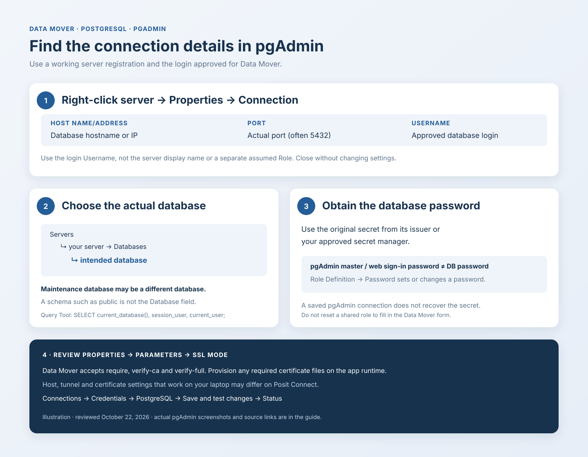

# Find PostgreSQL connection details in pgAdmin

Use an existing, working **pgAdmin** server registration to find the settings for
**Connections → Credentials → PostgreSQL** in Data Mover. Obtain the password from its issuer
or your approved secret manager; saved pgAdmin access is not a password-recovery method.
Use the database login approved for Data Mover, which may differ from your administrative login.

**Reviewed October 22, 2026** against pgAdmin 4 **9.18**, the official PostgreSQL references below,
and this app's [credential fields](../../app/services/secret_catalog.py),
[validation](../../app/services/secret_validation.py), and
[PostgreSQL connector](../../app/connectors/postgres.py).
Older pgAdmin versions may arrange the same settings differently.



*The map is an illustration. The attributed pgAdmin images and Data Mover capture below are actual
screenshots. Use them to locate fields, rather than copying their sample values.*

PostgreSQL uses a database password, so the API-token expiry field and warnings shown for
Foundry and Databricks do not apply. Data Mover does not inspect PostgreSQL role-password expiry.

## Before you test a live connection

Ask the operator to confirm that the deployment uses **`DATA_MOVER_MODE=real`** and has the
required [runtime configuration](../configuration.md#production) before entering real credentials.
The app defaults to `demo`, which uses emulators: **Connected** in an emulated check does not
verify remote credentials or access. The connection-check descriptions below apply to live mode.

In **Connections → Status**, read the full check message. An emulated/no-network result is not
a live check. After the operator changes the runtime mode, use **Test connection** again to
replace any previously saved emulated result.

## 1. Find the host, port, and login username

In pgAdmin's **Object Explorer**:

1. Expand **Servers** and locate the working server registration.
2. Right-click that server and choose **Properties → Connection**.
3. Copy **Host name/address**, **Port**, and **Username**. Close the dialog without changing it.

Use **Username**, not the server's display name or its separate **Role** field. The latter can
assume another role after login; Data Mover does not copy that behavior.
See [reviewing connection details](https://www.pgadmin.org/docs/pgadmin4/9.18/connect_to_server.html)
and the [Server dialog](https://www.pgadmin.org/docs/pgadmin4/9.18/server_dialog.html).


*Screenshot: pgAdmin 4 9.18, [Server dialog](https://www.pgadmin.org/docs/pgadmin4/9.18/server_dialog.html).
`localhost`, `5432`, and `postgres` are reference-image values, not instructions to use those values.
Vendor-hosted screenshots need internet access to load.*

For Data Mover's **Host**, enter only the database hostname or IP address. Keep the port in
**Port**; do not include `https://`, a `postgresql://...` connection string, or a URL path.
If pgAdmin uses a Unix socket, a **Service**, or an SSH tunnel instead of explicit network
settings, ask the operator for the host/port reachable from the Data Mover runtime. This form
expects explicit connection fields and does not reproduce pgAdmin's tunnel configuration.

## 2. Find the actual database and confirm the role

Expand **Servers → your server → Databases** and select the database that contains the intended
tables. Use its exact name for Data Mover's **Database**. If needed, right-click that database
and review **Properties → General → Database**. The **Owner** shown there is not necessarily
your login. See the [Object Explorer](https://www.pgadmin.org/docs/pgadmin4/9.18/tree_control.html)
and [Database dialog](https://www.pgadmin.org/docs/pgadmin4/9.18/database_dialog.html).

Do not automatically copy **Maintenance database** from the server registration: it is pgAdmin's
initial connection database and can differ from the one containing your tables. A schema such
as `public` or `reporting` is also not a database; select the schema later in the Pipeline page.

The **Login/Group Roles** node can help confirm the approved login's name and whether it can log in.
It also contains roles without login rights; do not choose an arbitrary role from that list.
The [role dialog](https://www.pgadmin.org/docs/pgadmin4/9.18/role_dialog.html) distinguishes login
rights from membership and other privileges. Use the account issued for Data Mover rather than
assuming the example `postgres` account is appropriate.

### Optional: confirm the connected database and identity

With the intended database selected, open **Tools → Query Tool** and run this read-only query:

```sql
SELECT current_database() AS database_name,
       session_user AS session_login,
       current_user AS effective_role;
```

`current_database()` identifies the connected database. Normally `session_user` is the login;
`current_user` can differ after a role change. Compare the output with the server registration
and your approved Data Mover login. This query does not retrieve a password.
Sources: [pgAdmin Query Tool](https://www.pgadmin.org/docs/pgadmin4/9.18/query_tool.html) and
[PostgreSQL session information functions](https://www.postgresql.org/docs/current/functions-info.html#FUNCTIONS-INFO-SESSION).

## 3. Obtain the database password

Use the password issued for that **PostgreSQL login role**, from its owner/administrator or the
approved secret manager. Enter it exactly as issued; special characters do not need URL encoding
in Data Mover's separate password field.

A masked or empty pgAdmin password field does not tell you the original password. The role's
**Definition → Password** control sets/changes a password; it is not a way to recover the old
one. Do not reset a shared role just to populate this form. pgAdmin also documents that
[server exports omit passwords](https://www.pgadmin.org/docs/pgadmin4/9.18/import_export_servers.html#json-format).

The [pgAdmin master password](https://www.pgadmin.org/docs/pgadmin4/9.18/master_password.html)
unlocks saved connection passwords. It is not the database role password, and neither is your
pgAdmin web sign-in password. If pgAdmin connects through Kerberos, certificates, a password file,
or a generated short-lived token, ask the operator for the authentication setup that Data Mover
can use. The form requires a password and does not run pgAdmin password-generation commands or
refresh expiring credentials automatically.

## 4. Check SSL settings in pgAdmin

Open the server's **Properties → Parameters** and review **SSL mode** and any certificate
settings. Older pgAdmin versions may use an **SSL** tab. Note the policy your database requires;
Data Mover offers only the three modes below.


*Screenshot: pgAdmin 4 9.18, [Server dialog](https://www.pgadmin.org/docs/pgadmin4/9.18/server_dialog.html).
The image's `prefer` value is **not offered by Data Mover**. Confirm an accepted mode with your operator.*

| Data Mover SSL mode | Meaning |
| --- | --- |
| **require** | App default. Requires encryption; does not check that the hostname matches the certificate. |
| **verify-ca** | Requires encryption and validates the certificate chain using trusted root certificates. |
| **verify-full** | Also validates the requested hostname against the certificate. |

PostgreSQL [documents these modes and certificate requirements](https://www.postgresql.org/docs/current/libpq-ssl.html).
For compatibility, `require` can also validate the CA when a root certificate file exists; use an
explicit verification mode when certificate verification is required. If pgAdmin uses `prefer`,
`allow`, or `disable`, resolve the SSL setup with the operator instead of assuming the same
connection will work with Data Mover's modes.

Certificate trust must be provisioned for the **Data Mover/Posit Connect runtime account**.
The form has no root-certificate upload field. The operator can supply libpq's `PGSSLROOTCERT`
or its runtime `~/.postgresql/root.crt`; pgAdmin's local certificate path is not copied by saving
these credentials. Client-certificate deployments may also need `PGSSLCERT` and `PGSSLKEY`.
See [libpq environment variables](https://www.postgresql.org/docs/current/libpq-envars.html).
`PIPELINE_CA_BUNDLE`, used by HTTP providers, is not passed as the PostgreSQL root certificate
by this connector.

## 5. Fill in Data Mover and test

Open **Connections → Credentials → PostgreSQL**:

| Data Mover field | Value |
| --- | --- |
| **Host** | The approved hostname/IP from step 1, reachable from the app runtime |
| **Port** | The actual listener port; the form defaults to `5432` |
| **Database** | The intended database from step 2 |
| **Username** | The approved PostgreSQL login role, not an assumed role or pgAdmin account |
| **Password** | The database password from step 3 |
| **SSL mode** | `require`, `verify-ca`, or `verify-full`, matching deployment policy |
| **Connect timeout (seconds)** | Optional; form default `10`. Accepted range is `1`–`60`; pgAdmin's `0`/unlimited value is not accepted. |
| **Application name** | Optional; default `data-mover`, used to identify the client session |

Choose **Save and test connection** for the first save, or **Save and test changes** when replacing
credentials, then check **Connections → Status**. For an unchanged credential bundle, use
**Test connection** to force a fresh check. In live mode, the connector opens a database connection,
runs `SELECT 1` and an identity query, and reports the database and effective user. It does not
create a table or test all transfer privileges. Confirm the reported database/user is the expected
one before selecting a schema and table in Pipeline.

<details>
<summary>View the actual Data Mover PostgreSQL credential form</summary>


*October 21, 2026 offline-demo capture, version `211026.0`, with synthetic credentials.
See the [capture gallery and manifest](../screenshots/README.md). This is a form-layout reference,
not evidence of a live PostgreSQL login.*

</details>

## Permissions and Posit Connect access

A successful pgAdmin session establishes access from **pgAdmin's machine**. The database must
also accept connections from the Connect runtime through its network/firewall rules and
`pg_hba.conf` or managed-service equivalent. `localhost` and `127.0.0.1` refer to the caller's own
environment; a laptop tunnel address generally cannot be copied into a deployed app. Database
traffic uses PostgreSQL network controls; the HTTP-provider hostname allowlist does not configure
that access.

The app does not copy pgAdmin's **Role**, SSH tunnel, **Post Connection SQL**, or desktop service
files. Have the operator arrange the intended database identity, effective privileges, and network
route for the runtime. Closing a pgAdmin tunnel can otherwise leave a copied address unusable.

| Intended use | Access the operator must verify |
| --- | --- |
| Connect | A login role, database `CONNECT`, and permitted client authentication |
| Read a table | Schema `USAGE` and table `SELECT` |
| Any destination mode | Schema access and `CREATE` for Data Mover's staging tables in the destination schema, even when the target table already exists |
| Append | Target `INSERT`, plus any sequence/default/constraint requirements |
| Upsert | Target `INSERT` and `SELECT`, `UPDATE` for the update action, and the chosen real primary/unique constraint |
| Replace | Ownership rights required by the connector; compatible replacement also needs `INSERT`/`DELETE`, while recreate needs permission to drop/replace the table |

These combine [PostgreSQL privileges](https://www.postgresql.org/docs/current/ddl-priv.html),
[upsert requirements](https://www.postgresql.org/docs/current/sql-insert.html), and the app's
[readiness/staging implementation](postgres.md#run-readiness-preflight). Identity columns,
sequences, row-level policies, and schema changes can add requirements; the operator should verify
the selected write mode with the intended role. Creating a new schema, when requested, also
requires database `CREATE`. A connection test alone does not verify these permissions.

## Troubleshoot by symptom

| Symptom | Check next |
| --- | --- |
| Host format rejected | Use a hostname or IP, with no URL scheme/path or embedded port. Unix socket paths are not accepted by this form. |
| Works in pgAdmin, but times out in Data Mover | Runtime DNS, listener/port, firewall, database client rules, and dependence on a laptop SSH tunnel |
| Authentication failed | Correct PostgreSQL role/password and authentication policy; do not use the pgAdmin login/master password |
| SSL/certificate failure | Required SSL mode, runtime CA files, certificate hostname match, and any client certificate/key setup |
| Connected to the wrong database | Use the intended **Databases** entry rather than blindly copying **Maintenance database** |
| Expected privileges are missing | pgAdmin may use another assumed role or post-connection SQL; the app logs in as the supplied database role |
| Connected, but tables are absent or a transfer fails | Schema/table privileges, supported identifiers, target write-mode requirements, and `PIPELINE_ENABLE_POSTGRES_WRITER` for writes |

To rotate the password, obtain the replacement through your normal process, enter a complete
credential bundle in Data Mover, and save/test again. Deleting the connection removes the app's
encrypted copy; it does not change or revoke the database role's password.
