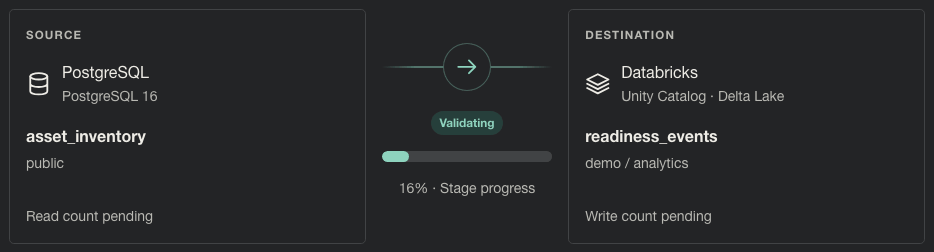
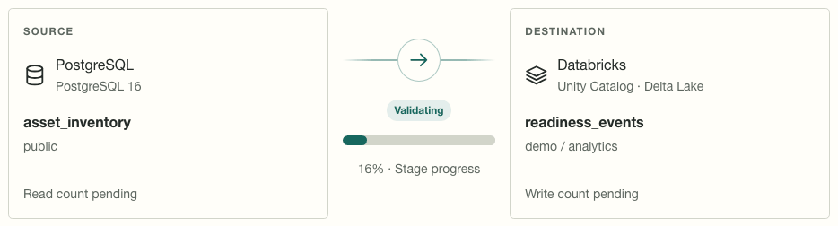

# Data Mover desktop screenshots

Refreshed October 21, 2026 with application version `211026.0`, based on `9e518e3` and the
current documentation working tree. These are actual Chromium captures of the Folio UI at
1440 × 1000, device scale 1. Full-page JPEGs include content below the viewport. The matching
[capture manifest](capture-manifest.json) records the capture time, state, and SHA-256 for each file.

## Gallery

| Screen | Dark | Light |
| --- | --- | --- |
| Sign in | [View](login.jpg) | [View](login-light.jpg) |
| Live PostgreSQL → Databricks transfer | [View](pipeline-live.jpg) | [View](pipeline-live-light.jpg) |
| Completed transfer panel | [View](transfer-complete-dark.jpg) | [View](transfer-complete-light.jpg) |
| Route setup and expanded navigation | [View](navigation-expanded.jpg) | [View](navigation-expanded-light.jpg) |
| Target schema preview | [View](schema-preview.jpg) | [View](schema-preview-light.jpg) |
| Saved routes | [View](saved-routes.jpg) | [View](saved-routes-light.jpg) |
| Encrypted connection forms | [View](connection-credentials.jpg) | [View](connection-credentials-light.jpg) |
| Four-provider connection status | [View](connections-status.jpg) | [View](connections-status-light.jpg) |
| Account | [View](account.jpg) | [View](account-light.jpg) |
| Team | [View](team.jpg) | [View](team-light.jpg) |
| Successful-transfer audit events | [View](audit-activity.jpg) | [View](audit-activity-light.jpg) |

The live monitor shows a successful three-row PostgreSQL source replacing the synthetic Delta table
`demo.analytics.readiness_events`. The schema comparison reports all four columns matching. The
connection screen includes MSS, MCS-COP, PostgreSQL, and Databricks. Account and Team contain only
the synthetic documentation administrator. Audit filters show successful pipeline completion.

See the [guardrail gallery](stories/README.md) for all eleven focused story captures, findings,
Hash/Remove choices, blocked and failed outcomes, transformed schemas, and audit evidence.

## Transfer animation

The recordings show the actual demo lifecycle through loading to success in each mode. Frame
intervals come from capture timestamps. The native stage percentage is not a measurement of bytes
transferred. Packet motion runs only during loading and settles to a static success check.
The manifest lists the observed states; no state, progress value, UI style, or connector delay is
injected. GIF playback itself does not inherit the browser's reduced-motion preference; use the
static completed panels above when motion is undesirable.





## Fixture and scope

- A separate SQLite database, synthetic documentation account, fake encrypted credentials, and
  loopback server are used. Remote systems are never contacted. Use only a disposable local demo.
- The capture script refuses non-loopback targets and checks the simulated-environment footer.
  It saves a replace route, executes it, checks success and row counts, then captures both modes.
- Theme changes use the normal preferences action. Tabs use their ordinary controls. DOM content,
  CSS, and provider responses are not changed for screenshots.
- Captures check page-level horizontal overflow, browser exceptions, four-provider presence,
  and terminal run success. A human visual inspection remains necessary.
- These screenshots demonstrate the offline UI, not live PAT acceptance, compute startup,
  Unity Catalog permissions, or Delta publication guarantees. See the
  [Databricks operator guide](../providers/databricks.md).
- Mobile is outside this desktop capture scope. Release notes, archived plans, and dated QA
  artifacts retain their original evidence.

## Reproduce

Prerequisites: the repository virtualenv, Node.js, Playwright with Chromium, and optionally a Python
interpreter with Pillow for GIF encoding. Install Playwright/Pillow in your preferred tooling
environment; they are documentation tools, not application runtime requirements. Set `NODE_PATH`
when Playwright is provided by an external runtime.

From the repository root, create a fresh temporary directory and start the demo in one terminal:

```sh
DOCS_DEMO_DIR=$(mktemp -d)
DEMO_DATABASE_URL="sqlite:///${DOCS_DEMO_DIR}/docs.db" \
  DEMO_PORT=8878 \
  DEMO_ADMIN_EMAIL=docs@example.gov \
  DEMO_ADMIN_PASSWORD='Quartz-Beacon-62!Harbor' \
  make demo
```

Use a free port. This leaves the usual `data-mover-demo.db` untouched. Stop the server after
capture and remove the temporary directory when finished.

In a second terminal:

```sh
node scripts/capture_docs_screenshots.cjs
```

To regenerate the lifecycle GIFs as well, select a Python executable with Pillow:

```sh
DOCS_ANIMATION_PYTHON=/path/to/python-with-pillow \
  node scripts/capture_docs_screenshots.cjs
```

The optional environment variables `DOCS_BASE_URL`, `DOCS_EMAIL`, and `DOCS_PASSWORD` can point the
script at a differently configured isolated demo. The base URL defaults to `http://127.0.0.1:8878`.
Use a fresh database per complete capture so saved routes and audit records stay uncluttered.
The script writes 22 JPEGs and their manifest; GIF-enabled runs also write two animations and
record their frame counts and observed states. Temporary animation frames are removed automatically.
If loading was missed between polls, the animation capture fails rather than labeling a still image
as a transfer recording; rerun it.

Refresh the guardrail panels with their separate [fixture instructions](stories/README.md#reproduce).
Inspect the images and compare captions against visible UI, then run:

```sh
make docs-check
node --check scripts/capture_docs_screenshots.cjs
node --check scripts/capture_guardrail_screenshots.cjs
git diff --check
```
