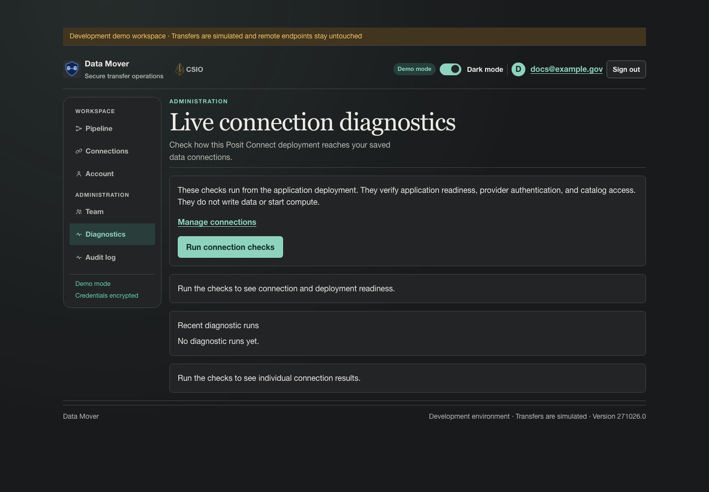

# Data Mover: Admin access and live connection checks

Jira story [CDO-5031](https://idstjira.socom.mil/jira/browse/CDO-5031) · Epic [CDO-5030](https://idstjira.socom.mil/jira/browse/CDO-5030) · [Issue export](../../artifacts/jira/data-mover-live-diagnostics-issues.csv)

## User story

As a Posit Connect administrator, I want to check my saved connections from the deployed app so I
can tell whether a problem is with the deployment, my credentials, or a provider.

## Why this helps

The app on Posit Connect reaches data sources from the Connect environment. Checking from a Mac
or CI runner cannot confirm that the deployed app has the same network route or provider access.
This story lets the administrator check those connections where the app actually runs.

## How to run the checks

1. Sign in to the Posit Connect deployment with an administrator account.
2. Open **Administration → Diagnostics** and choose **Run connection checks**.
3. Review the result for the deployment and each configured connection. Use **Manage connections**
   when a credential needs attention.
4. Reopen a previous result from the run history, or copy/download the report to share with a
   developer.

The screenshot shows the page before a check starts. [View the light theme](../screenshots/live-diagnostics-light.jpg).

## What the results tell you

The checks report whether the application database and private transfer storage respond, whether
saved provider credentials can connect, and whether supported catalogs or compute are ready. The
page distinguishes a missing or disabled connection from a failed check, so an unconfigured
provider does not look like an authentication failure.

Each result includes a status and a short explanation. When a check needs developer help, the
report includes a support reference that can be matched to application diagnostics.

## Safety and limits

- Checks use the signed-in administrator's saved connections and run from the Posit Connect
  deployment.
- This story performs read-only readiness checks. It does not write to source or destination data,
  start compute, or prove that a complete transfer will succeed.
- The report omits credentials and raw data values. Share the report and its support references,
  not copied secrets or customer records.
- A passing check describes connectivity at the time it ran. Provider permissions or network
  conditions can change later.

## Expected result

An administrator can run deployment-scoped connection checks, see which checks passed or need
attention, reopen the result, and share a safe report with developers. Non-administrators cannot
run or view an administrator's diagnostic results.

## Related epic scope

The later epic stories add approved scratch resources, a verified synthetic smoke transfer, wider
route and write-mode coverage, and data-integrity checks. See the [epic overview](live-deployment-diagnostics-epic.md).
